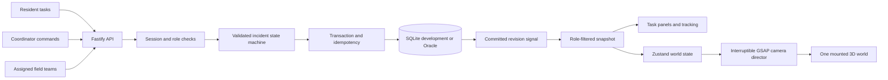

# NouDilo runtime architecture

NouDilo uses one persistent React Three Fiber canvas beside an accessible task panel. Server-confirmed commands update the same incident state used by the coordinator, assigned field teams, resident tracking, and world cues.

## Runtime boundaries

- `src/model.ts` owns the state transitions, resource reservations, recording, and verification guards. `src/priority.ts` explains the priority suggestion from duration, affected household estimates, additional support needs, and severity. Overlapping household estimates are not summed.
- `server/actions.ts` validates command payloads, including photo MIME type, size, and file signatures. `server/service.ts` checks roles, assignment ownership, resident ownership, idempotency, public projections, and notifications.
- `server/persistence.ts` supplies transactional SQLite and Oracle adapters. SQLite preserves the existing `.noudilo` database. Oracle uses the official `oracledb` Thin driver, a connection pool, bound values, explicit commit/rollback, and a locked canonical state row.
- `server/api.ts` implements the actual Fastify routes. Vite forwards API requests to that same server during development. `server/index.ts` serves the production build and API together.
- `src/session.ts` refreshes authorised data when an SSE revision arrives and falls back to periodic reads. The event stream carries no record data. Writes remain pending until an API response arrives; rejected requests never trigger confirmation signals.
- `src/world/state.ts` is the shared Zustand state. `NeighbourhoodDetails.tsx` supplies instanced property boundaries, roadside drains, lights, utility wires, landscape material, and the dispatch sign. `CameraDirector.tsx` owns camera travel and cancels superseded timelines. The scene remains mounted across route and role changes. Named destinations cover overview, village, house, shortage, leak, coordination, depot, route, delivery, and repair.
- `Stage.tsx` is a contextual world cue, not a renderer. Reporting and operational components never create their own canvases.

## Storage model

The running Oracle adapter uses a canonical JSON state document under a row lock. Each accepted command updates queryable JSON entity projections in the same transaction. Accounts, sessions, ownership, roles, geography, idempotency receipts, and notifications have dedicated relational tables. This is a functioning first adapter with intentionally serialised operational writes, suitable for a small evaluation deployment. It is not the higher-throughput, spatially indexed relational architecture proposed in `oracle-schema.sql`.

`server/migrations/001-runtime.sql` is the migration used by the adapter. It includes views for reports, community incidents, report links, tanker assignments, deliveries, repair work orders, repair evidence, incident history, audit logs, tankers, crews, and drivers. The migration runner also provisions the supported town coordinates.

Oracle starts with an empty inventory. Configure real vehicles, crews, and a water budget through `npm run inventory -- /path/to/inventory.json`, then provision staff accounts. The default local development inventory and isolated demonstration inventory are not production resource feeds.

## Authentication and permissions

Passwords are salted and scrypt-hashed on the server. Session cookies are HttpOnly and SameSite Strict; session tokens are hashed in storage and expire after eight hours. Set `NOU_SECURE_COOKIE=1` when serving HTTPS. Mutation requests validate their origin and JSON content type. Residents can submit and read their own reports; coordinators review, assign, publish, and verify; workers can mutate only their assigned vehicle or crew records. Private report text, evidence, audit details, unpublished delivery volumes, and precise leak descriptions are removed from the public projection.

The loopback-only demo login endpoint exists only in explicit demo mode, requires a separate SQLite directory, and selects only seeded demonstration accounts. It is disabled for normal local and Oracle operation. No demo credentials appear in the frontend bundle.

## Retry and concurrency behaviour

Every command accepts `Idempotency-Key`. A repeated actor/key/payload returns the committed receipt and current snapshot. Reusing the key with changed details is rejected. The browser retains the key across failed attempts. SQLite serialises transaction callbacks around `BEGIN IMMEDIATE`; Oracle locks `ND_STATE` before validation and allocation. Vehicle, water, and crew checks occur inside that transaction, preventing double dispatch.

A declined unaccepted tanker assignment releases the reservation and returns its shortage to the response queue. Delivered litres and approved litres are separate. Publication follows coordinator review; regular household supply restoration remains a separate command. Repair submission never verifies itself.

## Events and limitations

SSE signals are in-process; the five-second read fallback also picks up changes from another server process. An enterprise deployment should replace the in-process notifier with a durable transactional outbox. The notifications in this implementation are in-app records, not email or SMS.

Supporting photos are stored as bounded data URLs in private records. Private object storage, malware scanning, retention policies, password recovery, identity-provider integration, deployment TLS termination, backup operations, and production monitoring are not implemented by this local build. They should be configured before collecting real resident evidence publicly.

The Oracle adapter and migration runner are implemented. Connection-stub tests verify transaction/bind behaviour. Live Autonomous Database execution requires credentials and network access and has not been claimed as tested here.

Driver references: [Oracle connections and pooling](https://node-oracledb.readthedocs.io/en/latest/user_guide/connection_handling.html), [Oracle transactions](https://node-oracledb.readthedocs.io/en/latest/user_guide/txn_management.html), [R3F on-demand rendering](https://r3f.docs.pmnd.rs/advanced/scaling-performance).

## Explicit repair and supply confirmation

`verifyRepair` accepts an optional boolean `waterRestored`, validated by the server and restricted to coordinators. A repair may be verified without it. When true, the committed leak includes `waterRestoredAt`; the resident timeline and restored-household scene read that same record. This is not inferred from crew submission or tanker delivery. Accepted operational changes also set the linked resident reports' `updatedAt`, which is safe to expose through the existing owner-filtered projection. Existing JSON records need no destructive migration.
